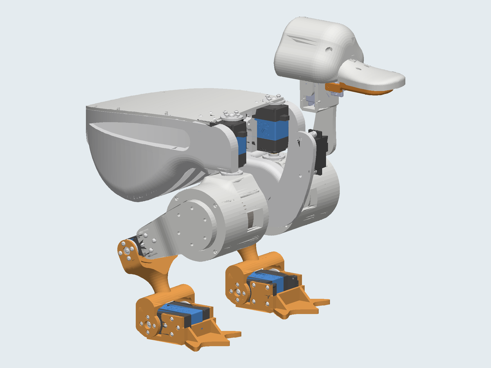
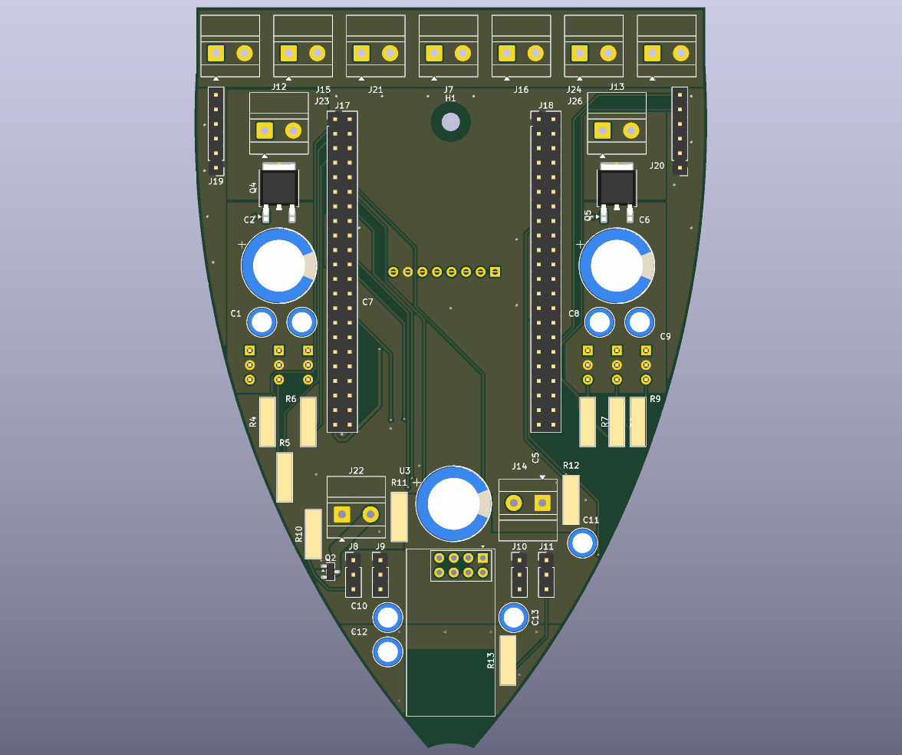

# Goober the RoboGoose

I wanted a robot goose that could wander around and quack all day. Getting it to take a decent step turned out to be a project of its own. Each leg has three RDS3245 servos and a 5010 brushless motor with a 3D-printed cycloidal gearbox.



I’ve printed and weighed some of the parts so the goose in MuJoCo is closer to the one I’m building. The printed thigh is 20 g, the tibia is 18 g, and one of those little servos weighs 60 g on its own. The head and neck weights are still estimates. So far, the walking tests are all in simulation.

## See Goober in MuJoCo

Download and unzip the [robot model](simulation/Goober-MuJoCo-legs.zip). Open a terminal in the folder that contains `goober.xml` and `meshes` and run these two commands.

```sh
python -m pip install mujoco==3.3.7
python -m mujoco.viewer --mjcf=goober.xml
```

That opens Goober in its starting pose. You can look around and inspect all eight leg joints. To try training it to walk, open the [gait notebook in Colab](https://colab.research.google.com/github/WUWHOoo/Goober/blob/main/simulation/Train-Goober-Gait.ipynb) and choose a CPU runtime. Run the cells in order. When the upload box appears, select the robot ZIP and the [starting policy ZIP](simulation/Goober-PPO-printed.zip) together. At the end you’ll see how often Goober falls on the original floor and on a slipperier one.

## Printed parts

The [Fusion assembly](CAD/Goober.f3d) is where you can see how the body fits around the motors, servos and encoders. If you’re interested in the gearbox, the [actuator STLs](CAD/Goober-Actuator-v3-STLs.zip) include the housings, cycloidal discs, output carrier and encoder shim. There’s also a [STEP file of the drive](CAD/Cyloidal%20Drive.step). I still need to export the other parts individually.

## Inside the body

I designed a two-layer board to connect the STM32H723, radio receiver, servos and two brushless motor drivers. The battery feeds three buck converters. Two supply 8.4 V to the leg servos, one for each side, and the third supplies 5 V.




The [KiCad 10 project](PCB/PDB.kicad_pro) has the board and schematic. The [Gerbers and drill file](PCB/gerbers.zip) are there too. The screw terminals are still placeholders. Before ordering the board, I need to pick the actual terminals and check how much current the battery and servo traces can carry. The parts list is in [Goober’s BOM](Goober-BOM.xlsx).

## Trying the controller

The [Arduino sketch](firmware/GooberBringup/GooberBringup.ino) is my first check for the STM32 board. With the motor supplies disconnected, select your STM32H723 board in the Arduino IDE using the STM32duino core and enable USB CDC as the generic Serial port. Upload the sketch, open Serial Monitor at 115200 baud and send `?`. It should reply with the number of milliseconds since startup.

I haven’t tested the sketch on Goober yet. Walking on the physical robot, a demo video and photos of the finished build are still ahead.
