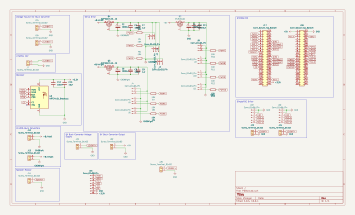

# Goober the RoboGoose

Goober is a goose I’m building because I want a little robot that’ll wander around and quack. I’ve printed parts of him already. I’m still figuring out the walking part in MuJoCo.


There are three RDS3245 servos in each leg. The hip also has a 5010 brushless motor and a cycloidal gearbox I printed. When I weighed the parts, the thigh came out to 20 g and the tibia was 18 g. One servo weighs 60 g, more than both prints together. Those are the numbers I’m using in the sim now. The head and neck are still my best guess.

## Try the sim

Unzip the [Goober model](simulation/Goober-MuJoCo-legs.zip). Open a terminal in the folder where you can see both `goober.xml` and `meshes`. Run these two lines there.

```sh
python -m pip install mujoco==3.3.7
python -m mujoco.viewer --mjcf=goober.xml
```

That opens the viewer so you can move the camera around and look at the eight leg joints.

To train the model, I relied on Google's CoLab. [Walking notebook](https://colab.research.google.com/github/WUWHOoo/Goober/blob/main/simulation/Train-Goober-Gait.ipynb) · [Starting policy ZIP](simulation/Goober-PPO-printed.zip) · [Robot ZIP](simulation/Goober-MuJoCo-legs.zip)

## What’s inside

The Fusion file has the whole goose. If you just want to see how the hip works, the gearbox has its own STEP file. The actuator ZIP has the printable pieces, down to the little shim for the encoder. I still need to export the other parts as individual STEP files. [Fusion assembly](CAD/Goober.f3d) · [Gearbox STEP](CAD/Cyloidal%20Drive.step) · [Actuator STLs](CAD/Goober-Actuator-v3-STLs.zip)

I made a two-layer PCB for the STM32H723, radio, servos and both motor drivers. Each side gets its own 8.4 V buck converter for the leg servos. A third converter supplies 5 V. All three run off the same battery.




[KiCad 10 project](PCB/PDB.kicad_pro) · [Gerbers and drill file](PCB/gerbers.zip) · [Parts list](Goober-BOM.xlsx)

## First power-up

The only firmware here so far is a little USB test. Send the board a `?` and it should tell you how long it’s been on. I haven’t tried it on Goober yet. [Arduino sketch](firmware/GooberBringup/GooberBringup.ino)

To try it, leave motor power disconnected. In the Arduino IDE, pick your STM32H723 board from the STM32duino core, enable USB CDC as the generic Serial port and upload the sketch. Open Serial Monitor at 115200 baud to send the `?`.

I’ll add photos and a demo once I have the real goose walking.
